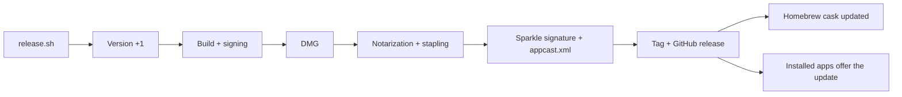

# Publishing a version

One command, from a clean `main`:

```bash
Scripts/release.sh            # 0.1.0 -> 0.1.1
Scripts/release.sh minor      # 0.1.1 -> 0.2.0
Scripts/release.sh 1.0.0      # an exact version
Scripts/release.sh --dry-run  # builds everything in dist/, publishes nothing
Scripts/release.sh 0.1.1 --dry-run --skip-notarization  # fast DMG while Apple has not answered (Gatekeeper will warn)
```

The script bumps the version, builds and signs the app, makes the DMG, notarizes it, signs the update for
Sparkle, writes `appcast.xml`, commits, tags and pushes, creates the GitHub release with the DMG and the
appcast, then updates the Homebrew cask. Release notes are the commit subjects since the previous tag: one clear
commit per task is enough.



## Pre-release while Apple is slow

Notarization can take hours the first time. To share a build before it is accepted, build a DMG without notarization
(`--skip-notarization`) and publish it by hand as a GitHub **pre-release**. A pre-release is never "latest": automatic
updates and Homebrew ignore it. People open it once with System Settings > Privacy & Security > "Open Anyway". The
real release (notarized) replaces it later.

## One-time setup

1. **Certificate**: Xcode > Settings > Accounts > Manage Certificates > "+" > *Developer ID Application*.
   Without it the script still builds (signed for development) but the app will not open without a warning on
   another Mac. The script finds the certificate by its SHA-1 hash, not its name: names with accents get mangled
   when passed through the shell.
2. **Notarization**: create an app-specific password at account.apple.com, then, in your own Terminal:
   ```bash
   xcrun notarytool store-credentials melies-notary --apple-id YOUR_APPLE_ID_EMAIL --team-id YOUR_TEAM_ID
   ```
   (the password is prompted for and stays in the keychain; never paste it anywhere else).
3. **Sparkle key**: generated once in the keychain ("Private key for signing Sparkle updates"). **Back it up**:
   without it no update can be signed for already installed apps. Export it to a file, open the file in a text
   editor (never print it in a shared terminal or chat), copy it into a password manager, then delete the file:
   ```bash
   .build/artifacts/sparkle/Sparkle/bin/generate_keys -x ~/Documents/melies-sparkle-key.backup
   ```
   If the private key ever leaks, replace it before publishing: delete the keychain item
   (`security delete-generic-password -s "https://sparkle-project.org" -a ed25519`), run `generate_keys` again, and
   put the new public key in `Scripts/Info.plist` (`SUPublicEDKey`). Apps already released with the old key could
   not be updated any more, so do this before the first release if you can.
4. **Public repository**: the app reads `appcast.xml` and downloads the DMG from GitHub without credentials.
   While the repository is private nobody but you can receive updates.
5. **Homebrew tap**: the repository `Benoitded/homebrew-melies` holds `Casks/melies.rb`. The release script
   rewrites it (version and sha256) after each release. Users install with
   `brew install --cask Benoitded/melies/melies`. If the tap is missing the script only prints a warning.

## Where things are set

| What | Where |
|---|---|
| Feed URL, public key, check frequency | `Scripts/Info.plist` (`SUFeedURL`, `SUPublicEDKey`, `SUScheduledCheckInterval`) |
| Menu item, automatic setting | `Sources/Melies/Updater.swift`, Advanced tab |
| Signing (hardened runtime, Sparkle inside out) | `Scripts/build.sh` |
| Cask template | `Scripts/release.sh` (last step) |
