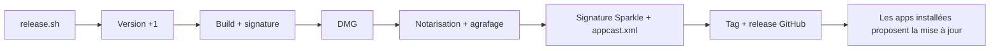

# Publier une version

Une commande, depuis `main` propre :

```bash
Scripts/release.sh            # 0.1.0 -> 0.1.1
Scripts/release.sh minor      # 0.1.1 -> 0.2.0
Scripts/release.sh 1.0.0      # une version précise
Scripts/release.sh --dry-run  # construit tout dans dist/, ne publie rien
```

Le script monte la version, construit et signe l'app, fait le DMG, notarise, signe la mise à jour pour Sparkle,
écrit `appcast.xml`, commit + tag + push, puis crée la release GitHub avec le DMG et l'appcast. Les notes de
version sont les sujets de commit depuis le tag précédent : un commit clair par tâche suffit.



## Réglage unique

1. **Certificat** : Xcode > Réglages > Comptes > Gérer les certificats > « + » > *Developer ID Application*.
   Sans lui, le script construit quand même (signé en développement) mais l'app n'ouvrira pas sans avertissement
   sur un autre Mac.
2. **Notarisation** : crée un mot de passe d'app sur appleid.apple.com, puis, dans ton Terminal :
   ```bash
   xcrun notarytool store-credentials melies-notary --apple-id TON_EMAIL --team-id 72P93X96LA
   ```
   (le mot de passe est demandé et reste dans le trousseau).
3. **Clé Sparkle** : déjà générée dans le trousseau (« Private key for signing Sparkle updates »).
   **Sauvegarde-la** : sans elle, plus aucune mise à jour ne peut être signée pour les apps déjà installées :
   ```bash
   .build/artifacts/sparkle/Sparkle/bin/generate_keys -x ~/Documents/melies-sparkle-key.backup
   ```
   Garde ce fichier hors du dépôt (gestionnaire de mots de passe, disque chiffré).
4. **Dépôt public** : l'app lit `appcast.xml` et télécharge le DMG sur GitHub sans identifiant. Tant que le
   dépôt est privé, personne d'autre que toi ne peut recevoir de mise à jour : passe-le en public avant la
   première release publique.

## Où ça se règle

| Quoi | Où |
|---|---|
| URL du flux, clé publique, fréquence de vérification | `Scripts/Info.plist` (`SUFeedURL`, `SUPublicEDKey`, `SUScheduledCheckInterval`) |
| Item de menu, réglage automatique | `Sources/Melies/Updater.swift`, onglet Avancé |
| Signature (hardened runtime, Sparkle inside-out) | `Scripts/build.sh` |
